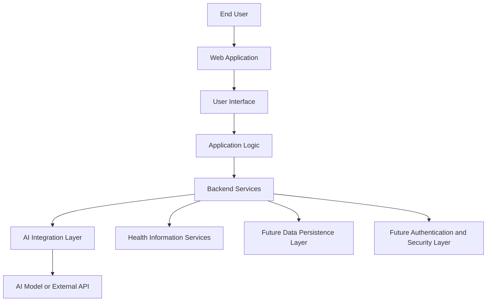

# FemCare AI

### AI-Powered Women's Health & Wellness Platform

> Bridging the gap between women's healthcare needs and accessible digital health solutions through artificial intelligence and human-centered technology.

---

## Table of Contents

- Project Overview
- Problem Statement
- Proposed Solution
- Project Objectives
- Product Capabilities
- System Architecture
- Technology Stack
- Repository Structure
- Installation and Setup
- Expected Outcomes
- Success Metrics
- Privacy, Security and Responsible AI
- Future Roadmap
- Scalability and Commercial Potential
- Project Limitations
- Contributing
- Medical Disclaimer

---

## 1. Project Overview

FemCare AI is an AI-driven digital health and wellness
initiative focused on improving women's access to
health information, personalized wellness guidance,
and preventive healthcare awareness.

The project aims to bring artificial intelligence,
health education, and digital wellness management
into a unified and accessible platform.

FemCare AI is designed with a user-centric approach,
emphasizing accessibility, usability, personalization,
privacy, and responsible use of artificial intelligence.

The long-term vision is to develop a comprehensive
digital ecosystem supporting women throughout
different stages of their health journey.

## 2. Problem Statement

Women's healthcare continues to face several
structural and technological challenges:

- Limited access to reliable health information.
- Lack of personalized healthcare guidance.
- Social stigma surrounding menstrual and
  reproductive health.
- Fragmented digital health services.
- Limited awareness of preventive healthcare.
- Difficulty monitoring long-term health patterns.
- Accessibility barriers in underserved communities.
- Lack of affordable initial wellness guidance.

These challenges create a need for an accessible,
intelligent, and user-friendly digital health platform.

## 3. Proposed Solution

FemCare AI proposes a unified digital platform that
leverages artificial intelligence and modern web
technologies to support women's health and wellness.

The platform is envisioned to help users:

- Access relevant health and wellness information.
- Ask health-related questions through a
  conversational interface.
- Understand menstrual and reproductive health.
- Monitor personal wellness patterns.
- Develop awareness of preventive healthcare.
- Make better-informed health-related decisions.
- Recognize when professional medical consultation
  may be appropriate.

FemCare AI is intended to complement existing
healthcare services rather than replace healthcare
professionals.

## 4. Project Objectives

### Primary Objectives

- Improve accessibility to women's health information.
- Reduce barriers to health education.
- Provide a personalized digital wellness experience.
- Encourage preventive healthcare awareness.
- Establish a foundation for AI-assisted wellness
  management.

### Engineering Objectives

- Develop a modular and maintainable codebase.
- Establish a scalable application architecture.
- Deliver a responsive and accessible user interface.
- Separate presentation and backend responsibilities.
- Enable future AI and healthcare integrations.
- Incorporate automated testing and code quality
  practices.
- Prioritize privacy and security by design.

## 5. Product Capabilities

The following capabilities represent the proposed
product scope and long-term product direction.

| Capability | Description |
|------------|-------------|
| AI Health Assistant | Conversational health information and wellness guidance |
| Menstrual Health | Cycle awareness and tracking |
| Personalized Wellness | Context-aware wellness recommendations |
| Health Education | Accessible women's health information |
| Mental Wellness | Emotional well-being resources |
| Health Dashboard | Centralized view of wellness information |
| Preventive Care | Awareness and health reminders |
| Responsive Interface | Accessible experience across devices |

Implementation status should be verified against
the current application source code.

## 6. Target Users

FemCare AI is designed for:

- Women seeking accessible health information.
- Individuals managing menstrual health.
- Students and working professionals.
- Individuals seeking preventive wellness guidance.
- Users with limited access to healthcare resources.
- Organizations promoting women's health awareness.

## 7. System Architecture

The following diagram represents the proposed
high-level system architecture and extension points.



### Architecture Layers

#### Presentation Layer

Responsible for:

- User interaction
- Responsive interface
- Navigation
- Information visualization
- Accessibility

#### Application Layer

Responsible for:

- Application workflows
- Business logic
- State management
- Input validation
- Communication with backend services

#### Backend Layer

Designed to support:

- Server-side operations
- API management
- External service integration
- Request processing
- Security controls

#### AI Integration Layer

Proposed responsibilities include:

- Natural language processing
- Conversational health assistance
- Context-aware responses
- Safety and response validation
- Health information retrieval

#### Data Layer

Future development may include:

- Secure user profiles
- Health and wellness records
- User preferences
- Historical wellness information
- Consent and privacy management

## 8. Technology Stack

The following technologies are identified from
the repository structure and configuration files.

| Technology | Purpose |
|------------|---------|
| TypeScript | Type-safe application development |
| Tailwind CSS | Responsive user interface styling |
| PostCSS | CSS processing |
| Nitro | Server-side infrastructure |
| pnpm | Dependency and package management |
| Playwright | End-to-end testing infrastructure |
| ESLint | Static code analysis and quality |
| Git | Version control |
| GitHub | Source code management and collaboration |

The architecture is intended to accommodate
additional technologies as the project evolves.

## 9. Repository Structure

```text
fem-care-ai/
│
├── src/
│   └── Application source code
│
├── server/
│   └── Server-side application logic
│
├── public/
│   └── Public and static resources
│
├── e2e-tests/
│   └── End-to-end testing
│
├── AI_RULES.md
├── components.json
├── eslint.config.js
├── index.html
├── nitro.config.ts
├── package.json
├── playwright-dyad.config.ts
├── pnpm-lock.yaml
├── pnpm-workspace.yaml
├── postcss.config.js
├── tailwind.config.ts
├── tsconfig.json
├── tsconfig.app.json
├── tsconfig.node.json
├── .gitignore
└── README.md
```

The repository separates application source code,
server-side components, static resources, testing,
and development configuration.

## 10. Installation and Setup

### Prerequisites

Ensure the following tools are installed:

- Node.js
- pnpm
- Git

Check package.json for supported runtime versions
and available scripts.

### Clone the Repository

```bash
git clone https://github.com/<username>/fem-care-ai.git
```

Replace `<username>` with the repository owner's
GitHub username or organization.

### Navigate to the Project Directory

```bash
cd fem-care-ai
```

### Install Dependencies

```bash
pnpm install
```

### Run the Development Server

If the development script is configured:

```bash
pnpm dev
```

Open the local development URL displayed
in the terminal.

### Available Scripts

To inspect the available project scripts:

```bash
pnpm run
```

Use the scripts defined in package.json for
development, production builds, linting, and testing.

### Environment Configuration

External AI services or future backend integrations
may require environment variables.

Never commit API keys, authentication credentials,
or sensitive configuration values to the repository.

## 11. Engineering and Quality Assurance

The project includes configuration for static
code analysis and end-to-end testing.

The engineering quality strategy should include:

- Component-level testing.
- End-to-end workflow validation.
- API integration testing.
- Responsive design testing.
- Accessibility testing.
- Performance optimization.
- Error handling and input validation.
- Security and privacy testing.
- AI response safety evaluation.

Future CI/CD pipelines should automate testing,
build validation, and deployment processes.

## 12. Expected Outcomes

### User Outcomes

- Improved access to women's health information.
- Greater awareness of personal health and wellness.
- Reduced information accessibility barriers.
- Increased understanding of preventive healthcare.
- Improved confidence in making informed
  health-related decisions.

### Technical Outcomes

- A modular digital health platform.
- A maintainable application codebase.
- A responsive and accessible user experience.
- A foundation for future AI integrations.
- An extensible architecture supporting new
  healthcare capabilities.

### Social Outcomes

- Increased awareness of women's health issues.
- Reduced stigma surrounding menstrual and
  reproductive health.
- Greater inclusion in digital healthcare.
- Improved accessibility for underserved communities.

These outcomes represent intended impact and
require validation through user research,
technical evaluation, and pilot studies.

## 13. Success Metrics

The following metrics are proposed for measuring
product effectiveness and technical performance.

| Metric | Measurement Objective |
|--------|-----------------------|
| User Activation Rate | Successful first-time user experience |
| User Retention | Continued platform engagement |
| Task Completion Rate | Ability to complete key workflows |
| User Satisfaction | Perceived usefulness and usability |
| AI Response Quality | Accuracy, relevance and safety |
| Response Latency | Application and AI performance |
| Error Rate | System reliability |
| Accessibility | Usability across diverse user groups |
| Health Awareness | Improvement in user understanding |
| Safety Incident Rate | Frequency of harmful or unsafe outputs |

Baseline measurements and target values should
be established during product validation.

## 14. Privacy, Security and Responsible AI

Health information is highly sensitive.
FemCare AI should follow privacy-by-design
and responsible AI principles.

Key engineering considerations include:

- Data minimization.
- Explicit user consent.
- Secure authentication.
- Encryption in transit and at rest.
- Role-based access control where applicable.
- Secure API communication.
- Protection against unauthorized access.
- Transparent data retention policies.
- AI hallucination mitigation.
- Medical misinformation prevention.
- Bias and fairness evaluation.
- Escalation to professional healthcare when needed.

AI-generated responses must not be presented as
clinically validated diagnoses unless appropriate
clinical validation and regulatory requirements
have been satisfied.

These principles represent security and safety
requirements rather than a claim of existing
implementation or regulatory certification.

## 15. Future Roadmap

### Phase 1 — Product Foundation

- Establish application architecture.
- Develop core user interface.
- Define primary user journeys.
- Establish development and testing workflows.

### Phase 2 — AI and Personalization

- Integrate conversational AI capabilities.
- Develop health information retrieval.
- Introduce context-aware wellness guidance.
- Implement AI response safety mechanisms.
- Evaluate AI response quality.

### Phase 3 — Health Management

- Menstrual cycle tracking.
- Personalized wellness dashboards.
- Health history management.
- Smart wellness reminders.
- Trend visualization and analytics.

### Phase 4 — Accessibility and Expansion

- Multilingual support.
- Regional language integration.
- Voice-enabled interaction.
- Progressive Web App support.
- Low-bandwidth optimization.
- Mobile application development.

### Phase 5 — Healthcare Ecosystem

- Healthcare professional integration.
- Telemedicine partnerships.
- Wearable device integration.
- Interoperable health information systems.
- Clinically reviewed knowledge resources.
- Advanced preventive healthcare capabilities.

### Phase 6 — Production Readiness

- Secure cloud infrastructure.
- Automated CI/CD pipelines.
- Monitoring and observability.
- Performance and load testing.
- Independent security assessments.
- Applicable healthcare regulatory assessment.
- Pilot deployments and outcome validation.

## 16. Scalability and Commercial Potential

FemCare AI has the potential to evolve from
a standalone digital wellness application into
a broader women's health technology ecosystem.

Potential expansion opportunities include:

- Consumer digital wellness services.
- Subscription-based wellness features.
- Corporate women's wellness programs.
- Educational institution partnerships.
- Hospital and clinic partnerships.
- NGO and public health initiatives.
- Rural healthcare accessibility programs.
- Telehealth integrations.
- Preventive wellness services.

Commercial opportunities should be evaluated
through market research, user validation,
clinical review, and regulatory assessment.

### Long-Term Product Vision

To build an accessible, intelligent, and trusted
digital health companion that supports women
throughout different stages of their lives,
while enabling collaboration with qualified
healthcare professionals.

## 17. Project Limitations

- AI-generated information may be inaccurate
  or incomplete.
- Clinical effectiveness requires formal validation.
- Personalization depends on available data quality.
- Healthcare regulations vary across regions.
- Sensitive health data requires additional
  security and privacy safeguards.
- Third-party AI integrations may introduce
  operational costs and service dependencies.
- Proposed capabilities may require further
  engineering and product development.

These limitations should be addressed through
continuous testing, expert collaboration,
responsible development, and user feedback.

## 18. Contributing

Contributions from software engineers, product
designers, healthcare researchers, AI engineers,
and other collaborators are welcome.

### Contribution Workflow

1. Fork the repository.
2. Create a feature branch.
3. Implement and test your changes.
4. Commit changes with descriptive messages.
5. Push the branch.
6. Submit a pull request for review.

```bash
git checkout -b feature/your-feature-name

git add .

git commit -m "feat: describe your changes"

git push origin feature/your-feature-name
```

Contributors should prioritize maintainability,
accessibility, security, documentation, and
responsible AI development.

## 19. License

A project license should be selected and documented
before public distribution or commercial adoption.

Refer to the LICENSE file once available.

## 20. Medical Disclaimer

FemCare AI is intended for educational,
informational, and general wellness purposes only.

It is not a substitute for professional medical
advice, diagnosis, or treatment.

Users should consult qualified healthcare
professionals for medical concerns and contact
appropriate emergency services in emergencies.

---

## Our Mission

To make women's health information more accessible,
intelligent, inclusive, and user-centric through
responsible technological innovation.

---

**FemCare AI**

*Artificial Intelligence. Human-Centered Healthcare.
Meaningful Impact.*
